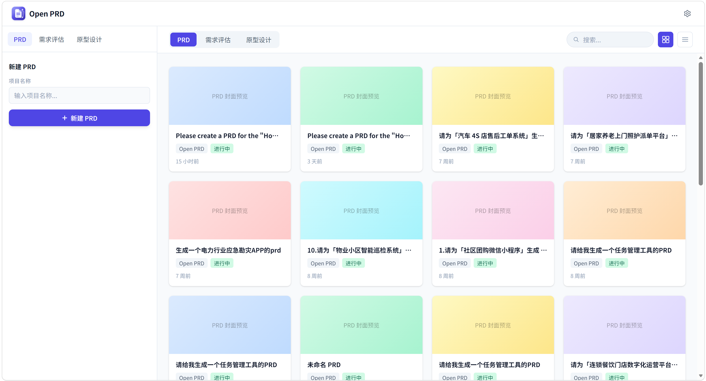
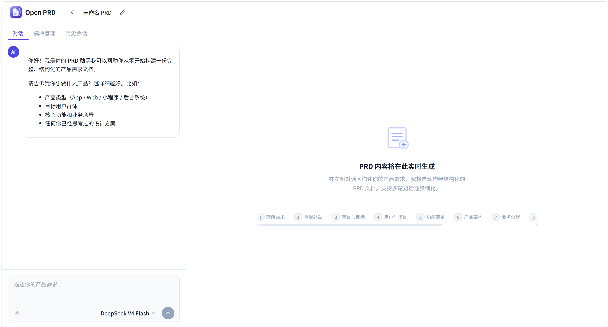
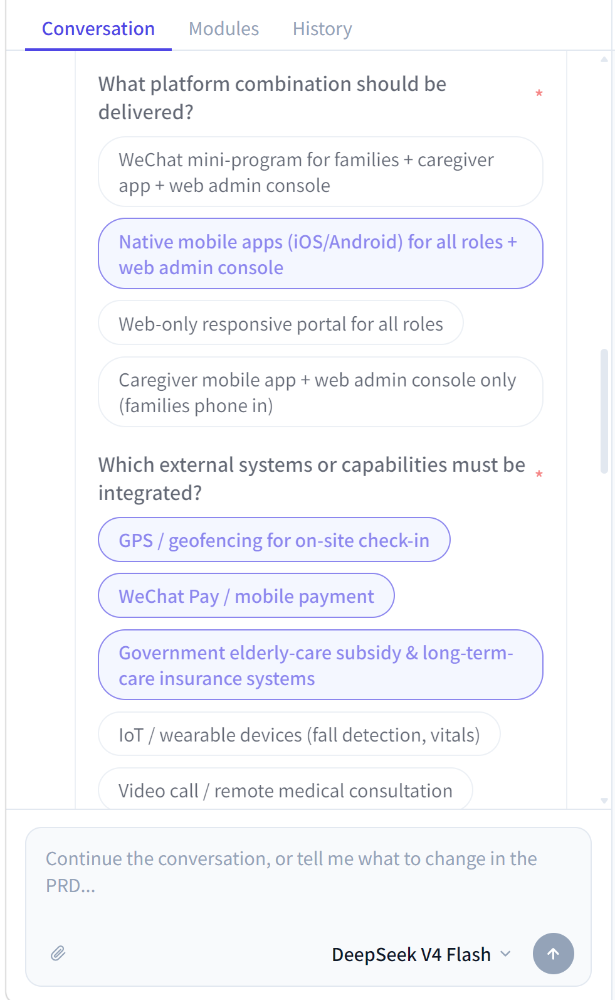
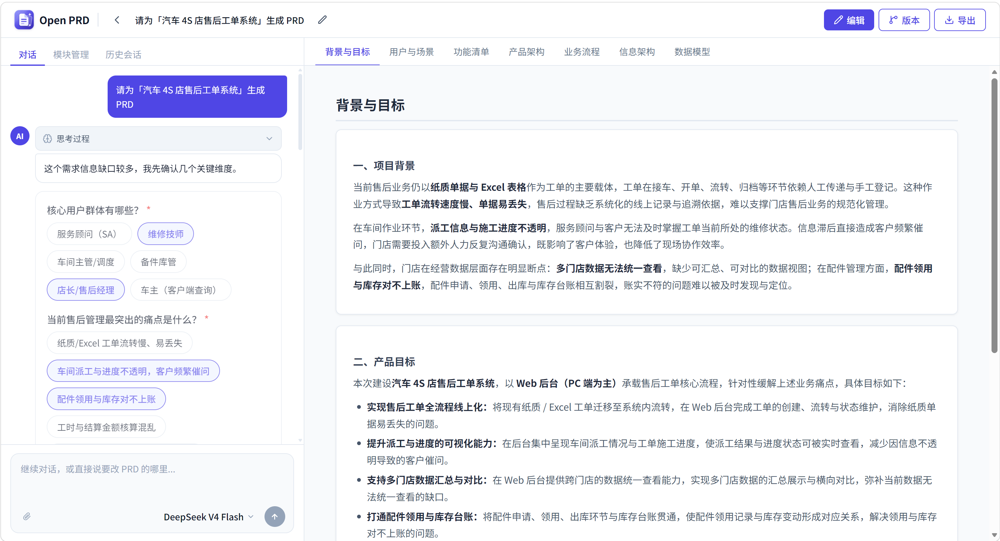
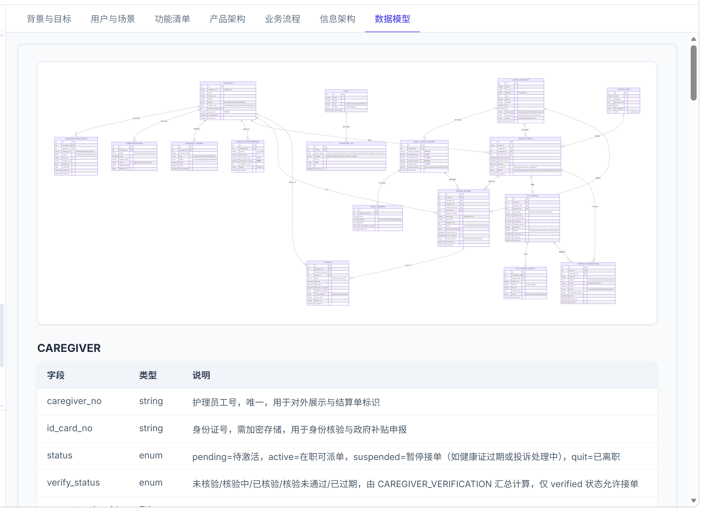
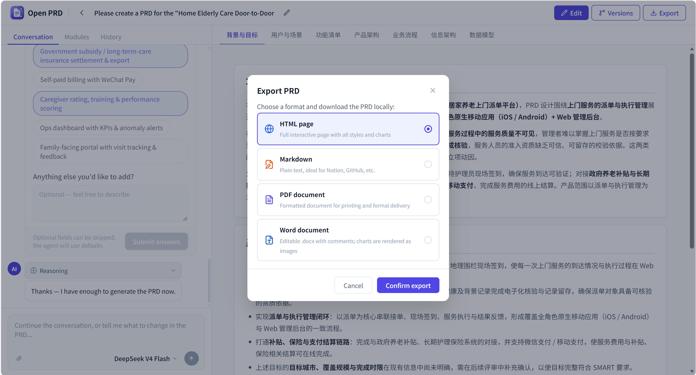
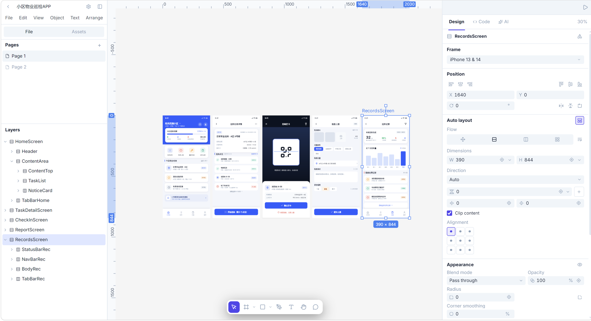
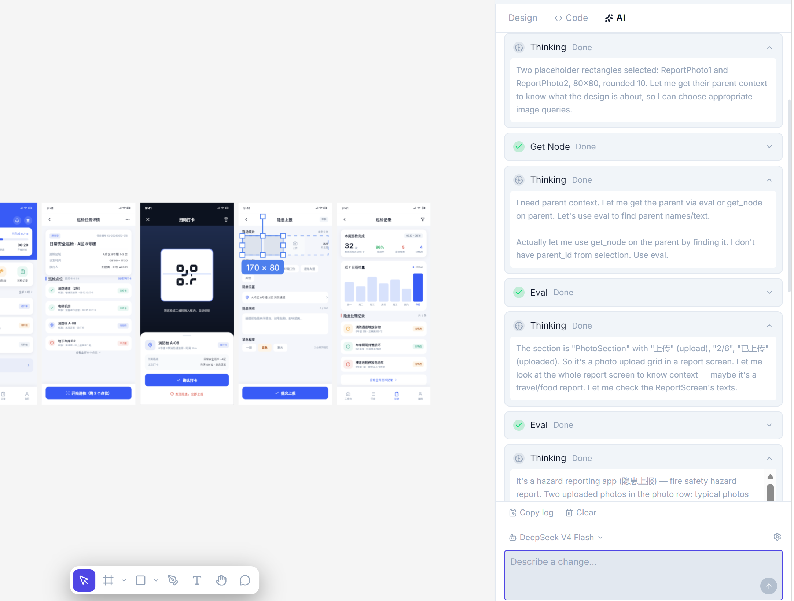
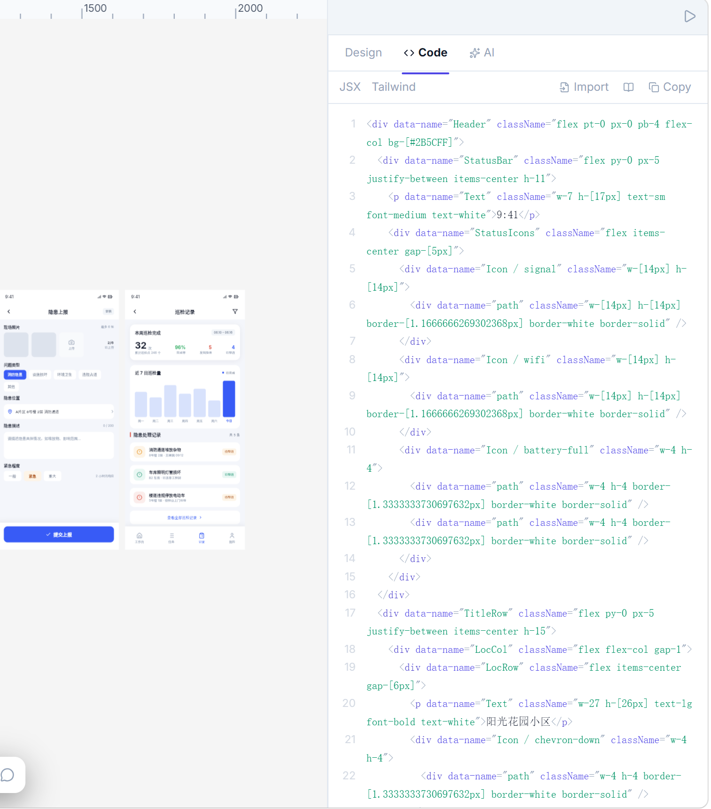
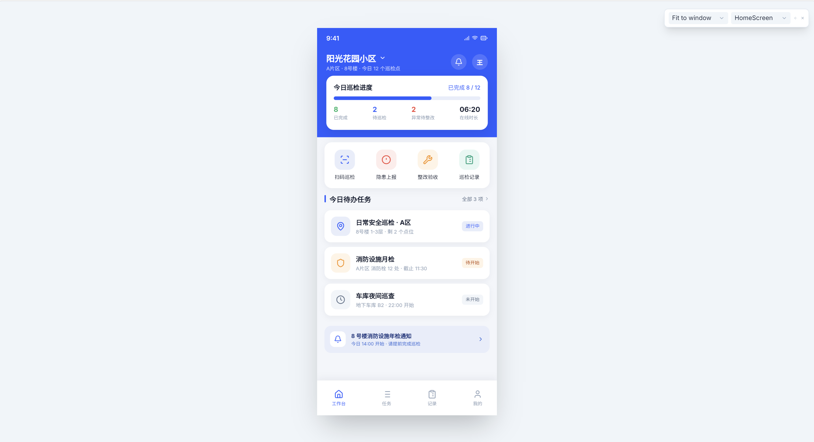

# Open PRD

**An AI workspace that turns rough product ideas into a complete, interactive PRD — and then into a clickable prototype.**

[简体中文](./README.zh-CN.md) · English

Open PRD is a local-first desktop and web application for product managers, founders and designers. Instead of throwing a one-line idea at a language model and hoping for the best, it first *interviews* you: it asks structured questions, confirms ambiguous decisions, then builds a structured PRD with architecture diagrams, flowcharts, a mind map and an ER model — all bundled into a single interactive HTML file. A built-in design editor lets you turn the "prototype basis" section into an actual prototype.

## Highlights

- **Guided requirement intake** — structured question forms and explicit confirmation before generation. No silent guessing.
- **8-section PRD, fully customizable** — background & goals, users & scenarios, feature list, product architecture, business flow, information architecture, data model, and prototype basis.
- **Real diagrams** — Mermaid (architecture / flow / ER) plus a markmap mind map, rendered directly in the exported HTML.
- **Interactive single-file export** — tabbed navigation with all CSS and JS embedded; Markdown, PDF and Word are available too.
- **Conversational editing** — pick a section or an element in the preview and ask the AI to rewrite it. Version history is built in (Figma-page style).
- **Built-in prototype editor** — powered by the OpenPencil engine (CanvasKit / Skia WASM + Yoga WASM), with layers, a properties inspector, PRD-grounded AI chat, JSX / Tailwind output, autosave and presentation mode.
- **Bring your own model** — OpenAI-compatible APIs, Anthropic, or a local Ollama model. No vendor lock-in.
- **Desktop builds for every platform** — Windows (NSIS + portable), macOS (dmg + zip) and Linux (AppImage + deb), produced by GitHub Actions.
- **Local-first and private** — conversations and PRDs are stored in a local SQLite database. No account, no cloud sync.

## PRD workflow in screenshots

**PRD library — start a new PRD or pick up an existing one**



**A new session — chat on the left, live PRD preview on the right**



**Structured intake — multi-select questions before the AI writes anything**



**Generated PRD — background and goals, with the intake form still available on the left**



**Data model — Mermaid ER diagram and entity tables**



**Export as interactive HTML, Markdown, PDF or Word**



## How it works

1. **Describe your idea.** Rough notes are fine — product type, target users, core scenarios, anything you already know.
2. **Answer structured questions.** The agent checks for gaps and presents a form with dropdowns, multi-selects and free-text fields.
3. **Confirm key decisions.** For ambiguous business rules or data flows, it lays out the options and waits for your choice.
4. **Generate.** It plans an outline first, then writes section by section, using dedicated diagram Skills for architecture, flow, information architecture and the data model.
5. **Review and refine.** Edit a section by hand in the preview, or ask the AI to change a specific element in chat. Switch between saved versions at any time.
6. **Export or prototype.** Download the interactive HTML, or open the prototype editor with the PRD as context.

## Getting started

### Option 1 — Desktop app (recommended)

Download an installer from [GitHub Releases](https://github.com/Tem-man/open-prd/releases):

| OS | Artifacts |
| --- | --- |
| Windows | `OpenPRD-Setup-<version>.exe` (NSIS installer), `OpenPRD-Portable-<version>.exe` |
| macOS | `OpenPRD-<version>-arm64.dmg`, `OpenPRD-<version>-x64.dmg` (and `.zip`) |
| Linux | `OpenPRD-<version>-x86_64.AppImage`, `OpenPRD-<version>-amd64.deb` |

> **Unsigned builds.** On macOS, right-click the app and choose **Open**, or run `xattr -cr /Applications/OpenPRD.app`. On Windows, SmartScreen may appear — choose **More info → Run anyway**. On Ubuntu 24.04+, an AppImage needs `sudo apt install libfuse2t64`.

### Option 2 — Run from source

Requirements: **Node.js 24.9.0** (pinned in `.nvmrc`) and **pnpm**. `npm` is not supported.

```bash
nvm use 24.9.0          # or: fnm use
pnpm install
cp backend/.env.example backend/.env
# edit backend/.env: choose a provider and set your API key
pnpm dev
```

Then open <http://localhost:5173>. The backend listens on port `3000` by default.

If you ever switch to a different major Node version and `pnpm dev` reports `NODE_MODULE_VERSION`, run `pnpm fix:native` once.

### Model configuration

Set `LLM_PROVIDER` in `backend/.env`:

| Provider | Settings |
| --- | --- |
| `openai` | `OPENAI_API_KEY`, `OPENAI_BASE_URL`, `LLM_MODEL` |
| `anthropic` | `ANTHROPIC_API_KEY`, `ANTHROPIC_BASE_URL`, `LLM_MODEL` |
| `ollama` | `OLLAMA_BASE_URL`, `LLM_MODEL` — no API key needed |

Any service exposing an OpenAI-compatible API — OpenRouter, DeepSeek, SiliconFlow, LM Studio and others — works by simply changing `OPENAI_BASE_URL`. The application never hardcodes a vendor.

## PRD structure

The default document has eight sections; you can add, remove or rename them in the conversation.

| # | Section | What it contains |
| --- | --- | --- |
| 1 | Background & Goals | Business pain points, SMART goals |
| 2 | Users & Scenarios | Personas and typical use cases |
| 3 | Feature List | Module × feature × priority table |
| 4 | Product Architecture | Layered Mermaid `graph TB` diagram |
| 5 | Business Flow | Mermaid `flowchart TD` diagram |
| 6 | Information Architecture | markmap mind map |
| 7 | Data Model | Mermaid `erDiagram` plus entity tables |
| 8 | Prototype Basis | Page inventory, page details, navigation and design guidelines — the input for the prototype AI |

## Prototype editor

Open PRD ships with a full design editor at `/prototype`, powered by the OpenPencil engine (CanvasKit / Skia WASM + Yoga WASM). It is not a passive mockup viewer: you can draw frames, edit vector layers, drive changes through AI, copy production-ready code and present the result. The PRD's "Prototype Basis" section is wired in as context, so the AI designs against the pages and guidelines you already confirmed.

### Three-panel canvas



Pages and a collapsible layer tree sit on the left, an infinite canvas with rulers and artboards in the middle, and a properties inspector on the right. Select a frame (for example, iPhone 13 & 14) to adjust position, auto layout, dimensions, clipping, alignment and appearance. The floating toolbar provides select, frame, shape, pen, text, hand and comment tools.

### AI editing that sees the selection



Switch the right panel to **AI**, choose a model, and type a change in plain language. The agent inspects the selected nodes, resolves their parent context, shows each step (Thinking / Get Node / Eval — all expandable) and then applies the edit on the canvas. Because it is grounded in the PRD, it knows what the screen is for instead of guessing from pixel positions.

### Design to code



The **Code** tab projects the current design into JSX with Tailwind classes. Nodes retain `data-name` labels, so the output stays readable and can be imported or copied into your codebase rather than rebuilt by hand.

### Interactive presentation



Presentation mode hides the editor chrome and shows one screen at a time, with fit-to-window, page switching and fullscreen controls — handy for walking stakeholders through a flow or testing interactions in a real page.

## Tech stack

| Layer | Technologies |
| --- | --- |
| Frontend | Vue 3.5, TypeScript, Sass, Vite 8, Pinia 3, LangChain.js |
| Backend | Node.js, Express, LangChain.js, daemon (PM2) process management |
| Persistence | SQLite + better-sqlite3 |
| Model providers | `@langchain/openai`, `@langchain/anthropic`, `@langchain/ollama` |
| Prototype engine | OpenPencil sources — CanvasKit / Skia WASM, Yoga WASM, Tailwind v4 |
| Desktop | Electron 42, electron-vite 5, electron-builder 26 |
| Package manager | **pnpm only** (`npm install` is not supported) |

## Development

```bash
pnpm dev                        # frontend + backend together
pnpm --filter frontend dev      # frontend only (http://localhost:5173)
pnpm --filter backend dev       # backend only (http://localhost:3000)
pnpm build                      # production build of both
pnpm lint
pnpm typecheck

pnpm dist:win                   # Windows NSIS + portable
pnpm dist:mac                   # macOS dmg + zip (macOS host required)
pnpm dist:linux                 # Linux AppImage + deb (Linux host recommended)
pnpm icon                       # regenerate icons from frontend/public/favicon.svg
```

Desktop packages are built natively on each platform by [`.github/workflows/desktop-release.yml`](./.github/workflows/desktop-release.yml). Pushing a `v*` tag builds all four targets and publishes a GitHub Release with checksums; the same can be done manually via **Run workflow** with `publish_release` enabled.

## Where your data lives

Everything is stored locally. The desktop app uses the OS application-data directory:

| OS | Location |
| --- | --- |
| Windows | `%APPDATA%/OpenPRD/` |
| macOS | `~/Library/Application Support/OpenPRD/` |
| Linux | `~/.config/OpenPRD/` |

That directory holds `prd.db`, prototypes, custom skills, `.env` and logs, and is preserved across upgrades and uninstalls. In development the database is `backend/data/prd.db` (git-ignored).

## Notes

- Prototype editor internals and upstream changes are documented in [`packages/PENCIL_UPSTREAM.md`](./packages/PENCIL_UPSTREAM.md).
- Desktop packaging details are in [`docs/electron-guide.md`](./docs/electron-guide.md).
- This repository does not currently include a license file.

---

**中文文档：[README.zh-CN.md](./README.zh-CN.md)**
