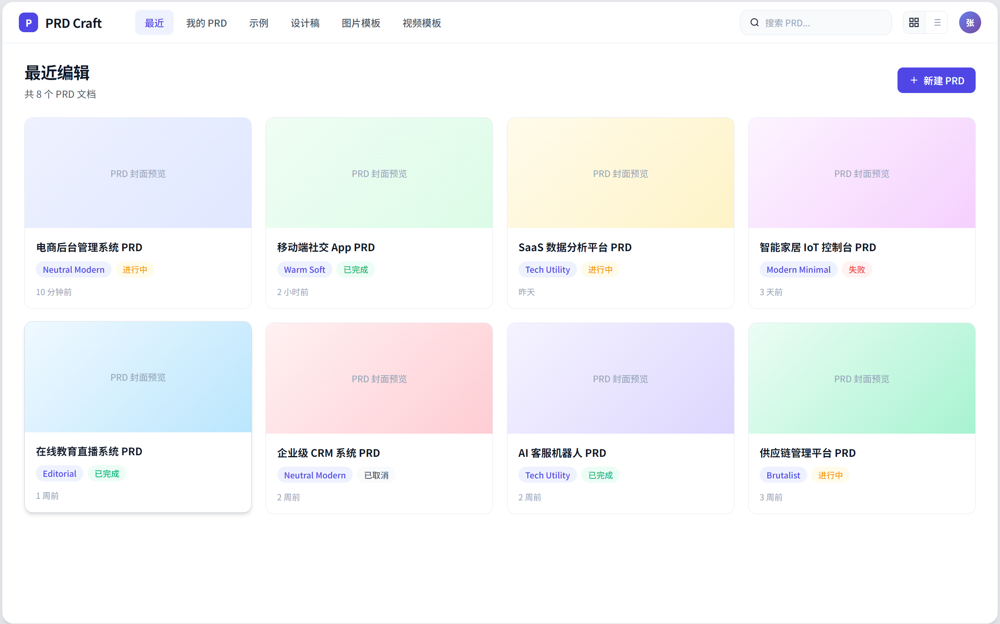
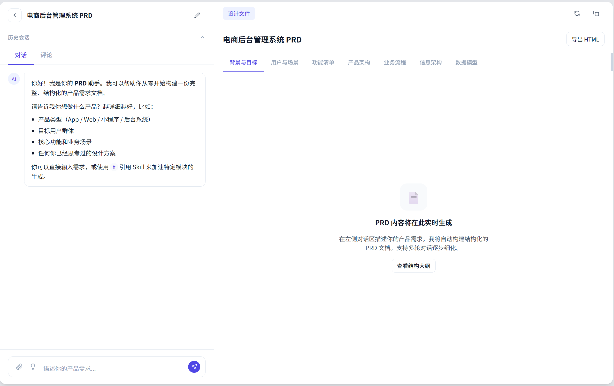
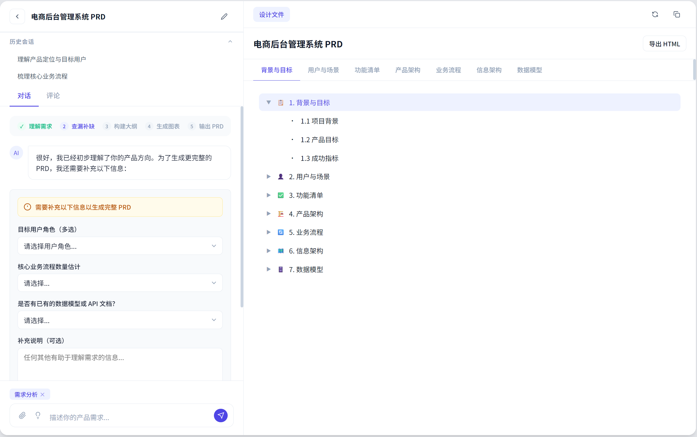
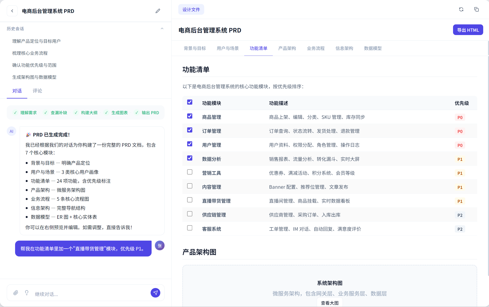
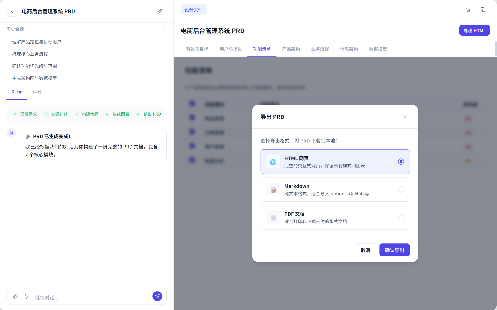

# Open PRD

**把零散的产品想法变成一份完整、可交互的 PRD，再进一步变成可点击的原型。**

简体中文 · [English](./README.md)

Open PRD 是一个本地优先的桌面 / Web 应用，面向产品经理、创业者和设计师。它不是把一句话丢给大模型碰运气，而是先「采访」你：用结构化表单补齐缺失信息，对关键决策做明确确认，然后生成一份包含架构图、业务流程图、信息架构脑图和数据模型的 PRD——全部打包进一个可交互的 HTML 文件。内置的设计编辑器还能以 PRD 为依据，把「原型设计依据」章节变成真正的原型。

## 核心特性

- **引导式需求澄清** —— 生成前先给结构化提问表单，关键环节要求显式确认，不做主观臆断。
- **8 个标准模块，可自由定制** —— 背景与目标、用户与场景、功能清单、产品架构、业务流程、信息架构、数据模型、原型设计依据。
- **真正的专业图表** —— Mermaid 绘制架构图 / 流程图 / ER 图，markmap 绘制信息架构脑图，导出后直接在 HTML 中渲染。
- **单文件交互导出** —— Tab 切换的 HTML，CSS / JS 全部内嵌，离线可看；同时支持 Markdown 与 PDF。
- **对话式编辑** —— 在预览中点选模块或元素，用对话让 AI 改写；内置类似 Figma Page 的版本管理。
- **内置原型编辑器** —— 基于 OpenPencil 引擎（CanvasKit / Skia WASM + Yoga WASM），具备图层树、属性面板、结合 PRD 上下文的 AI 对话、自动保存与放映模式。
- **模型自由切换** —— OpenAI 兼容接口、Anthropic、本地 Ollama，不绑定单一厂商。
- **全平台桌面安装包** —— Windows（NSIS + 便携版）、macOS（dmg + zip）、Linux（AppImage + deb），由 GitHub Actions 原生构建。
- **本地优先，数据私有** —— 会话与 PRD 存在本地 SQLite，无需账号、不上传云端。

## 界面预览

**PRD 工作台首页**



**会话页：左侧对话，右侧实时 PRD 预览**



**结构化信息收集：信息不足时 AI 先提问，再动笔**



**关键设计决策逐条确认**


**生成结果：功能清单表格与架构图**



**导出为交互 HTML、Markdown 或 PDF**



## 工作流程

1. **描述想法** —— 越 rough 越好，产品类型、目标用户、核心场景，想到什么写什么。
2. **回答结构化问题** —— Agent 检查信息缺口，给出下拉框、多选、填空组合的提问表单。
3. **确认关键决策** —— 遇到有歧义的业务规则或数据流向，它会列出选项等你拍板。
4. **开始生成** —— 先规划大纲，再逐模块生成；架构、流程、信息架构、数据模型分别调用对应的图表 Skill。
5. **审阅与修改** —— 在预览里手动编辑某个章节，或在对话中让 AI 改指定元素；随时切换已保存的版本。
6. **导出或做原型** —— 下载交互 HTML，或者以 PRD 为依据打开原型编辑器继续设计。

## 开始使用

### 方式一：桌面安装包（推荐）

从 [GitHub Releases](https://github.com/Tem-man/open-prd/releases) 下载对应系统的安装包：

| 系统 | 产物 |
| --- | --- |
| Windows | `OpenPRD-Setup-<版本>.exe`（安装版）、`OpenPRD-Portable-<版本>.exe`（便携版） |
| macOS | `OpenPRD-<版本>-arm64.dmg`、`OpenPRD-<版本>-x64.dmg`（另有 `.zip`） |
| Linux | `OpenPRD-<版本>-x86_64.AppImage`、`OpenPRD-<版本>-amd64.deb` |

> **安装包未签名。** macOS 上需右键 → 打开，或执行 `xattr -cr /Applications/OpenPRD.app`；Windows 可能弹 SmartScreen，选择「更多信息 → 仍要运行」；Ubuntu 24.04+ 运行 AppImage 需先装 `sudo apt install libfuse2t64`。

### 方式二：源码运行

环境要求：**Node.js 24.9.0**（见 `.nvmrc`）与 **pnpm**。不支持 `npm`。

```bash
nvm use 24.9.0          # 或 fnm use
pnpm install
cp backend/.env.example backend/.env
# 编辑 backend/.env：选择模型协议并填入 API Key
pnpm dev
```

然后打开 <http://localhost:5173>，后端默认监听 `3000` 端口。

如果切换到其他 Node 大版本后 `pnpm dev` 报 `NODE_MODULE_VERSION` 不匹配，执行一次 `pnpm fix:native` 即可。

### 模型配置

在 `backend/.env` 中设置 `LLM_PROVIDER`：

| 协议 | 需要配置 |
| --- | --- |
| `openai` | `OPENAI_API_KEY`、`OPENAI_BASE_URL`、`LLM_MODEL` |
| `anthropic` | `ANTHROPIC_API_KEY`、`ANTHROPIC_BASE_URL`、`LLM_MODEL` |
| `ollama` | `OLLAMA_BASE_URL`、`LLM_MODEL` —— 无需 API Key |

任何提供 OpenAI 兼容 API 的服务——OpenRouter、DeepSeek、SiliconFlow、LM Studio 等——改一下 `OPENAI_BASE_URL` 就能接入，代码里没有写死厂商。

## PRD 文档结构

默认输出八个章节，也可以在对话中增删或改名。

| # | 章节 | 内容 |
| --- | --- | --- |
| 1 | 背景与目标 | 业务痛点、SMART 目标 |
| 2 | 用户与场景 | 用户画像、典型使用场景 |
| 3 | 功能清单 | 功能模块 × 功能点 × 优先级表格 |
| 4 | 产品架构 | Mermaid `graph TB` 分层架构图 |
| 5 | 业务流程 | Mermaid `flowchart TD` 流程图 |
| 6 | 信息架构 | markmap 思维导图 |
| 7 | 数据模型 | Mermaid `erDiagram` + 实体说明表格 |
| 8 | 原型设计依据 | 页面清单、页面详情、导航关系与设计规范，供原型 AI 使用 |

## 技术栈

| 层级 | 技术 |
| --- | --- |
| 前端 | Vue 3.5、TypeScript、Sass、Vite 8、Pinia 3、LangChain.js |
| 后端 | Node.js、Express、LangChain.js、PM2 守护进程 |
| 持久化 | SQLite + better-sqlite3 |
| 模型 Provider | `@langchain/openai`、`@langchain/anthropic`、`@langchain/ollama` |
| 原型引擎 | OpenPencil 源码 —— CanvasKit / Skia WASM、Yoga WASM、Tailwind v4 |
| 桌面端 | Electron 42、electron-vite 5、electron-builder 26 |
| 包管理 | **仅 pnpm**（不支持 `npm install`） |

## 开发命令

```bash
pnpm dev                        # 前端 + 后端一起启动
pnpm --filter frontend dev      # 仅前端（http://localhost:5173）
pnpm --filter backend dev       # 仅后端（http://localhost:3000）
pnpm build                      # 前后端生产构建
pnpm lint
pnpm typecheck

pnpm dist:win                   # Windows NSIS + 便携版
pnpm dist:mac                   # macOS dmg + zip（须在 macOS 主机执行）
pnpm dist:linux                 # Linux AppImage + deb（建议 Linux 主机）
pnpm icon                       # 从 frontend/public/favicon.svg 重新生成图标
```

桌面安装包由 [`.github/workflows/desktop-release.yml`](./.github/workflows/desktop-release.yml) 在各平台原生构建。推送 `v*` 标签会自动构建全部四个目标并发布带校验和的 GitHub Release；也可以在 Actions 页面点 **Run workflow** 并勾选 `publish_release` 手动发布。

## 数据存在哪里

所有数据都留在本地。桌面版按操作系统放到应用数据目录：

| 系统 | 路径 |
| --- | --- |
| Windows | `%APPDATA%/OpenPRD/` |
| macOS | `~/Library/Application Support/OpenPRD/` |
| Linux | `~/.config/OpenPRD/` |

其中包含 `prd.db`、原型文件、自定义 Skill、`.env` 与日志，升级和卸载都会保留。开发模式下数据库位于 `backend/data/prd.db`（已加入 `.gitignore`）。

## 其他说明

- 原型编辑器的实现细节与上游改动记录见 [`packages/PENCIL_UPSTREAM.md`](./packages/PENCIL_UPSTREAM.md)。
- 桌面打包的设计与踩坑记录见 [`docs/electron-guide.md`](./docs/electron-guide.md)。
- 本仓库目前未附带 License 文件。

---

**English README：[README.md](./README.md)**
