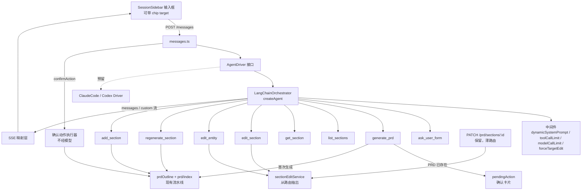
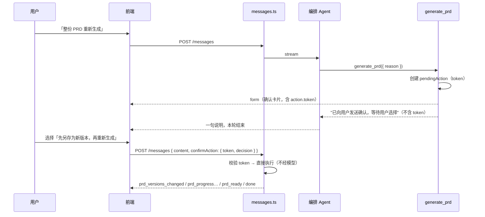

# 升级计划：编排 Agent + 细粒度工具（createAgent）

> 状态：已实现（P0–P3），待用真实模型跑 §14.1 回归 | 创建时间：2026-09-26
>
> 实现偏差：阶段切换直接按请求构建系统提示与工具列表（未使用 `dynamicSystemPromptMiddleware` / `phaseToolsMiddleware`）；
> 确认执行器位于 `messages.ts` 的 `handleConfirmAction`；工具内部 token 按 LangGraph 节点名 `model_request` 过滤。
>
> 范围：后端 PRD 对话 Agent（`services/agent.ts`）、PRD 生成流水线入口、PRD 模块 AI 编辑（`routes/sessions/sectionEdit.ts`）、会话页对话流 SSE。
>
> 关系：本方案**取代** [`plan-prd-edit-as-chat.md`](./plan-prd-edit-as-chat.md) §2.1 的「前端路由器 + 两条 Agent」与 §6.1 的「独立摘要 LLM 调用」；
> 该文档中的 chip 交互、`messages.meta`、撤回栏、聊天气泡形态**保留并沿用**。

---

## 一、背景与问题

| #   | 现状                                                                                                                                                                                                                               | 后果                                                                                             |
| --- | ---------------------------------------------------------------------------------------------------------------------------------------------------------------------------------------------------------------------------------- | ------------------------------------------------------------------------------------------------ |
| 1   | 主 Agent（[agent.ts](../backend/src/services/agent.ts)）是手写状态机，靠文本标记驱动：模型输出 `[GENERATE_PRD]` / `[QUESTION_FORM]…[/QUESTION_FORM]`，[messages.ts](../backend/src/routes/sessions/messages.ts) 再解析标记接管流程 | 标记容易漏写、写错、夹带 HTML；提示词里大量篇幅用于约束输出格式；无法扩展新能力                  |
| 2   | 编辑逻辑（[sectionEdit.ts](../backend/src/routes/sessions/sectionEdit.ts)）是独立端点 `PATCH /prd/sections/:sectionId`，只能由前端显式调用，分实体 / 元素 / 整模块三种模式；路由里混着提示词、LLM 调用、HTML 补丁与持久化          | 能力无法被 Agent 复用；不进聊天记录                                                              |
| 3   | 对话框没有编辑意图识别                                                                                                                                                                                                             | 用户在聊天里说「给用户表加个手机号字段」，主 Agent 只会继续收集需求或误触发整篇 `[GENERATE_PRD]` |

## 二、目标与非目标

### 目标

1. **一个编排 Agent**：基于 LangChain.js `createAgent`，统一处理「信息收集 → 生成 PRD → 对话式编辑」全生命周期。
2. **细粒度工具**：按「操作类型」拆工具（模块作为参数），工具内部复用现有确定性流水线，不重写生成 / 补丁逻辑。
3. **对话式编辑**：自然语言编辑可自动定位模块 / ER 实体；一次请求可跨模块联动修改。
4. **去掉文本标记协议**：`[GENERATE_PRD]`、`[QUESTION_FORM]` 由工具调用取代。
5. **前端 SSE 协议向后兼容**：现有 `delta` / `thinking` / `form` / `prd_progress` / `prd_ready` / `error` / `done` / `section_edit_*` 事件语义不变。
6. **意图可判定、可验证**：「问答 / 局部编辑 / 单章重写 / 功能变更 / 全局变更 / 整份重新生成 / 新增章节」有明确判定规则（§6.3），并有固定回归用例集衡量准确率（§14.1）。
7. **整份重新生成不可误触**：PRD 已存在时整份重新生成必须经服务端两步确认（§4.5），模型无法自行确认。

### 非目标（本期不做）

- 不做模型能力降级：默认所接入模型均支持工具调用（含推理模型），**不保留标记协议兜底**。
- 不引入 LangGraph checkpointer；`messages` 表仍是对话唯一事实来源。
- 不做多 Agent / supervisor / 子 Agent 架构。
- 不按模块拆工具（`generate_background`、`edit_feature_list` 之类）。
- 不改 PRD 生成流水线内部（大纲 + 逐模块生成器 + Skill 注入）与 HTML 渲染。
- 不改原型编辑器（`src/pencil`）内的 AI Chat。
- Claude Code / Codex 驱动只预留接口，不实现。

---

## 三、总体架构



分层职责：

| 层                 | 职责                                                               | 禁止                       |
| ------------------ | ------------------------------------------------------------------ | -------------------------- |
| 路由 `messages.ts` | 鉴权 / 参数校验、写用户消息、初始化 SSE、调用 Driver、落库助手消息 | 解析模型输出、决定业务流程 |
| `AgentDriver`      | 屏蔽 Agent 实现，输出统一事件流                                    | 直接写 `res`               |
| 编排 Agent         | 决定何时提问 / 生成 / 读取 / 编辑，给用户自然语言说明              | 自己输出 PRD 正文或 HTML   |
| 工具               | 参数校验 + 调用服务 + 推送进度 + 返回**精简**结果                  | 把完整 HTML 回传模型       |
| 服务               | 现有生成流水线、section 编辑、持久化                               | 依赖 Express `req/res`     |

---

## 四、工具设计

### 4.1 工具清单

| 工具                 | 适用阶段   | 复用                                                                                               | 返回给模型（精简）                                                                                                                         |
| -------------------- | ---------- | -------------------------------------------------------------------------------------------------- | ------------------------------------------------------------------------------------------------------------------------------------------ |
| `ask_user_form`      | 全程       | [questionForm.ts](../backend/src/routes/sessions/helpers/questionForm.ts) 的表单结构 + `writeForm` | `"表单已发送，等待用户填写"`，**本轮随即结束**                                                                                             |
| `generate_prd`       | 全程       | `generatePrdOutline` + `generateFullPrd` + `finalizePrd`（拆分后）                                 | 首次生成：已生成模块列表 + 校验警告数；PRD 已存在：`"已向用户发送确认，等待用户选择"`（见 §4.5）                                           |
| `list_sections`      | PRD 已生成 | `prd_sections`（`is_current = 1`）+ `module_templates`                                             | 每个模块：`id`、`title`、纯文本摘要（≤150 字）、数据模型附实体名列表；另附模块库中**未选用**的模块（`id` + `name`），供 `add_section` 使用 |
| `get_section`        | PRD 已生成 | 同上                                                                                               | 模块**纯文本**内容（去标签，≤4000 字）；可选 `includeHtml` 返回截断 HTML                                                                   |
| `edit_section`       | PRD 已生成 | 整模块改写 / 元素补丁（见 4.3）                                                                    | `{ sectionId, version, changeHint }`                                                                                                       |
| `edit_entity`        | PRD 已生成 | 实体补丁（`extractEntityBlock` / `applyEntityPatch`）                                              | `{ entityName, isNew, version }`                                                                                                           |
| `regenerate_section` | PRD 已生成 | `generateSingleSection`                                                                            | `{ sectionId, version }`                                                                                                                   |
| `add_section`        | PRD 已生成 | `module_templates` + `sessions.selected_modules` + 大纲追加 + `generateSingleSection`              | `{ sectionId, title, version, createdTemplate }`                                                                                           |

工具总数 8 个，工具列表**按请求构建**（`buildTools(ctx)`）。工具描述中列出当前会话的模块 id，自定义模块自动纳入。

### 4.2 Schema（zod）

```ts
// 不用 z.enum：同一轮 add_section 之后模块列表会变化，改为执行时按 DB 最新模块校验
const sectionIdSchema = z
  .string()
  .describe(`PRD 模块 id，当前可选：${ctx.moduleIds.join(" / ")}`);

ask_user_form: z.object({
  intro: z.string().max(200).describe("表单上方的一句提示语"),
  questions: z
    .array(
      z.object({
        id: z.string(),
        label: z.string(),
        type: z.enum(["single_choice", "multi_choice", "text"]),
        options: z.array(z.string()).min(2).max(6).optional(),
        required: z.boolean(),
        placeholder: z.string().optional(),
      }),
    )
    .min(1)
    .max(6),
});

generate_prd: z.object({
  reason: z
    .string()
    .max(300)
    .optional()
    .describe("PRD 已存在时填写用户要求整份重新生成的原话摘要；首次生成留空"),
});

list_sections: z.object({});
get_section: z.object({
  sectionId: sectionIdSchema,
  includeHtml: z.boolean().default(false),
});
edit_section: z.object({
  sectionId: sectionIdSchema,
  instruction: z.string().min(1).max(2000),
});
edit_entity: z.object({
  entityName: z.string().min(1).max(64),
  instruction: z.string().min(1).max(2000),
});
regenerate_section: z.object({
  sectionId: sectionIdSchema,
  reason: z.string().max(500).optional(),
});
add_section: z.object({
  templateId: z
    .string()
    .optional()
    .describe("模块库中已有模块的 id（优先使用）"),
  title: z
    .string()
    .min(1)
    .max(30)
    .optional()
    .describe("模块库中没有对应模块时的新章节标题"),
  description: z.string().max(200).optional(),
  afterSectionId: sectionIdSchema
    .optional()
    .describe("插入到该模块之后，缺省追加到末尾"),
  keyPoints: z.array(z.string().max(200)).max(8).optional(),
});
```

`add_section` 行为：

- `templateId` 与 `title` 二选一，都缺省时返回错误；`templateId` 已在当前会话中时返回「该模块已存在，可用 edit_section」。
- 仅给 `title` 时新建一条自定义 `module_templates`（`is_builtin = 0`、无 Skill，走 `custom.ts` 兜底生成路径），可在「模块管理」中删除。
- 写 `sessions.selected_modules` 时**不能**复用 `PATCH /sessions/:id/modules` 的逻辑——该路由会把 `outline` 置空，导致已生成模块的断点续传状态丢失。改为新增 `appendSectionOutline(sessionId, section, afterSectionId)`：只往大纲里追加一条（`keyPoints` 为空时用一次小模型调用补全），再调用 `generateSingleSection`。
- 完成后推送 `session_modules_updated`（§8），前端刷新模块列表与 Tab。

表单的业务规则（每组必须且只含一道可选 text 题、用户群体 / 痛点 / 场景必须多选等）在工具内**代码校验**，不合规时返回错误文本让模型重试，而不是只靠提示词约束。

### 4.3 精确定位参数不经模型

`selectedElementHtml`、`tablePath`、`entityName`（点选来源）这类 DOM 定位参数**不出现在工具 schema 中**，模型无法伪造：

- 前端带 chip 发送时，请求体携带 `target`（与 `plan-prd-edit-as-chat.md` §7.1 的 `ComposerTarget` 一致）。
- `target` 进入运行时上下文 `ctx.target`。
- `edit_section` 执行时：若 `ctx.target` 带元素信息 → 走**元素补丁**；带 `entityName` → 走**实体补丁**；否则若传入 `search_targets` 返回的 `locatorId`（或 instruction 对内部索引标签唯一命中）→ 服务端合成同样的元素 `target` 再打补丁；再否则 → **整模块改写**。`locatorId` 属于当轮扫描的白名单，不是模型伪造的 DOM。详见 [`plan-chat-element-locate.md`](./plan-chat-element-locate.md)。
- 自然语言提到实体（「给用户表加手机号」）时由模型调用 `edit_entity`，实体名来自 `list_sections` 返回的实体列表，服务端校验存在性（不存在则按新实体处理并在结果中标注 `isNew`）。

### 4.4 工具返回值原则

- 只返回模型做下一步决策所需信息：id、版本号、一句话变更提示、警告。
- **禁止**把完整 HTML 放进 `ToolMessage`，避免 token 暴涨与模型复读 HTML。
- 工具失败时返回可读错误（`"模块 xxx 不存在，可用模块：…"`），不抛异常中断整个 Agent；不可恢复错误（DB 异常、中止）才抛出。

### 4.5 整份重新生成：服务端两步确认

**触发条件**：PRD 已存在（`ctx.prdId !== null`）时调用 `generate_prd`。收集阶段的首次生成不需要确认。

**设计原则**：确认必须来自用户在界面上的显式操作，模型既拿不到也伪造不了确认凭据；确认后的执行是确定性动作，由路由直接执行，不再经过模型判断。



**pendingAction**：

- 存在本轮助手消息的 `meta.pendingAction`：`{ token, kind: "regenerate_prd", prdId, activeVersionId, expiresAt, status: "pending" | "consumed" | "cancelled" }`。
- `token` 用 `crypto.randomUUID()` 生成，单次有效，30 分钟过期，绑定 `sessionId` + `prdId` + 当前激活版本 id（期间切换过版本则失效）。
- `token` 只随 `form` 事件下发给前端，**不进入** `ToolMessage` 和历史回放。

**确认卡片**：复用 `QuestionForm`，表单数据新增 `action` 字段：

```json
{
  "intro": "整份重新生成会覆盖当前所有模块（包括你手动和 AI 做过的修改），请选择：",
  "questions": [
    {
      "id": "decision",
      "label": "如何处理当前内容？",
      "type": "single_choice",
      "required": true,
      "options": ["先另存为新版本，再重新生成", "直接覆盖重新生成", "取消"]
    }
  ],
  "action": { "token": "…", "kind": "regenerate_prd" }
}
```

选项按**下标**映射为 `save_version_then_regenerate` / `overwrite` / `cancel`，不依赖文本匹配。没有 `action` 字段的旧表单行为不变。

**路由收到 `confirmAction`**：

1. 校验：token 存在、状态为 `pending`、未过期、会话与激活版本匹配；不通过则返回 `error`（`retryable: false`，`reason: "confirm_expired"`），提示用户重新发起。
2. 先把状态置为 `consumed`（防重复提交），再按 `decision` 执行：
   - `save_version_then_regenerate`：先确保版本已引导（还没有任何版本时，先把当前工作区物化为 v1「当前内容」，与 `listPrdVersions` 的懒引导一致），再调用 `createPrdVersion({ mode: "duplicate", label: "整份重新生成" })`，然后在新激活版本上执行流水线；旧版本保留原内容。推送 `prd_versions_changed`。
   - `overwrite`：直接执行流水线。
   - `cancel`：状态置为 `cancelled`，固定回复「已取消，PRD 保持不变」。
3. 流水线为 `generatePrdOutline` → `generateFullPrd` → `validateGeneratedPrd`，推送的 SSE 事件与 §8 一致；本轮助手消息写固定文案（如「已按你的选择另存为 v3 并重新生成 PRD」）。
4. 用户消息的 `content` 写所选选项文本，`meta.confirmAction = { decision }`，历史回放可读。

「另存为新版本」由用户在确认卡片中显式选择，符合 AGENTS.md「版本仅由用户显式创建」的约束。

---

## 五、运行时上下文

```ts
interface OrchestratorContext {
  sessionId: string;
  prdId: string | null; // null = 尚未生成
  modules: SelectedModule[]; // 当前会话模块（有序）
  moduleIds: string[];
  target: ComposerTarget | null; // 前端 chip
  emit: (evt: OrchestratorEvent) => void; // 推给 SSE 映射层
  signal: AbortSignal; // 停止会话 / idle 超时
}
```

- 每次 `POST /messages` 构建一次 `ctx`、`tools`、`agent`（构建成本可忽略）。
- LLM 运行时配置沿用 `runWithLlmConfig`（AsyncLocalStorage）；整个 `agent.stream` 在其回调内执行，工具内部的 `createChatModel()` 自动拿到同一配置。
- 工具优先用 `config.writer` 推送自定义事件；`ctx.emit` 作为映射层的统一出口。

---

## 六、系统提示（按阶段动态切换）

使用 `dynamicSystemPromptMiddleware`，根据 `ctx.prdId` 选择提示：

| 阶段           | 提示                   | 可用工具                        |
| -------------- | ---------------------- | ------------------------------- |
| 收集（无 PRD） | `buildCollectPrompt()` | `ask_user_form`、`generate_prd` |
| 编辑（有 PRD） | `buildEditPrompt()`    | 全部 8 个                       |

工具可见性也按阶段过滤（`wrapModelCall` 中裁剪 `request.tools`），避免收集阶段误调编辑工具。

### 6.1 收集阶段要点（由现有 `buildSystemPrompt` 改写）

- 保留：信息诊断规则、两轮递进提问、模糊信息自行推断并注明假设、对话风格。
- 删除：`[QUESTION_FORM]` JSON 格式说明、`[GENERATE_PRD]` 触发格式与正反例。
- 改写为工具决策规则：
  - 信息不足 → 调 `ask_user_form`（第一轮 / 第二轮规则不变）。
  - 第二轮已回答，或首条消息信息充分 → 先输出一句简短说明，再调 `generate_prd`。
  - 禁止在文本中输出 HTML、Mermaid 或 PRD 正文。

### 6.2 编辑阶段要点（新增）

- 附当前模块清单（id + 标题 + 一句话说明）。
- 用户意图是修改 → 先 `list_sections` / `get_section` 确认位置（信息足够时可跳过），再调编辑工具；改完用 1–2 句话说明「在哪里改了什么」。
- 涉及数据模型实体 → 优先 `edit_entity`。
- 一处修改影响其他模块（如功能清单新增功能 → 业务流程 / 数据模型需同步）→ 先说明影响并逐个调用 `edit_section`；影响面超过 3 个模块时先用 `ask_user_form` 征求确认。
- 定位有歧义（0 个或多个模块命中）→ 用 `ask_user_form` 让用户选择模块，**不要猜**。
- 只有用户明确要求「整份重新生成」时才调用 `generate_prd`（服务端会发确认卡片，见 §4.5）。
- 纯问答 / 解释 → 直接回答，不调工具。
- 具体判定规则见 §6.3，以「判定表 + 不超过 10 条示例」的形式写进 `buildEditPrompt()`。

### 6.3 意图判定规则（编辑阶段）

**判定顺序**（先命中者生效）：

1. 请求带 chip `target` → 在目标模块内处理（§4.3）；含「重新生成 / 重写 / 重做」且没有具体改动内容 → `regenerate_section(target)`，否则 → `edit_section(target)`。
2. 没有改动动词的疑问或评价 → 问答。
3. 按下表匹配意图。
4. 都不命中或命中多个 → 歧义，用 `ask_user_form` 澄清。

| #   | 意图            | 判定信号                                                                                                  | 工具路径                                                                                                                       | 正例                                                 | 易混淆反例（实际归属）                                    |
| --- | --------------- | --------------------------------------------------------------------------------------------------------- | ------------------------------------------------------------------------------------------------------------------------------ | ---------------------------------------------------- | --------------------------------------------------------- |
| 1   | 问答 / 解释     | 疑问句、评价，没有改动动词                                                                                | 不调工具                                                                                                                       | 「这个架构图是什么意思」「数据模型设计得合理吗」     | 「数据模型不合理，帮我优化」→ 编辑                        |
| 2   | 局部编辑        | 改 / 加 / 删 / 换成 / 补充 + 具体内容，落在单个章节                                                       | `edit_section`                                                                                                                 | 「功能清单里把导出的优先级改成 P0」                  | 「功能清单重新写一下」→ #4                                |
| 3   | 实体编辑        | 提到表 / 实体 / 字段 / 属性                                                                               | `edit_entity`                                                                                                                  | 「给用户表加个手机号字段」「订单实体删掉备注字段」   | 「数据模型整体重做」→ #4                                  |
| 4   | 单章重写        | 章节名 + 重新生成 / 重写 / 重做 / 不满意重来，没有具体改动内容                                            | `regenerate_section`                                                                                                           | 「业务流程图重新生成一下」                           | 「业务流程加一个审批节点」→ #2                            |
| 5   | 功能变更        | 增删改**产品功能**（功能名不是 PRD 章节名）                                                               | 先 `edit_section(功能清单)`，再按影响同步业务流程 / 数据模型 / 信息架构 / 原型设计依据；影响超过 3 章先用 `ask_user_form` 确认 | 「再加一个支付模块」「去掉积分功能」                 | 「PRD 里加一个竞品分析章节」→ #8                          |
| 6   | 全局变更        | 平台、目标用户、核心定位、商业模式等基础前提改变                                                          | `ask_user_form` 二选一：「逐章同步更新（保留已有修改）」/「整份重新生成」；选后者再走 #7                                       | 「改成 App，不做 Web 了」「目标用户换成 B 端企业」   | 「App 端登录页加个验证码」→ #2                            |
| 7   | 整份重新生成    | 同时出现「整份 / 全部 / 整个 PRD / 所有模块」和「重新生成 / 重做 / 重写」                                 | `generate_prd` → §4.5 确认                                                                                                     | 「整份 PRD 重新生成」「全部模块重写一遍」            | 「重新生成一下」（无对象）→ #11；「功能清单重新生成」→ #4 |
| 8   | 新增章节        | 「章节 / 部分 / 模块」+ 属于**文档结构**的名称（竞品分析、风险评估、里程碑、非功能需求…）或模块库已有模块 | `add_section`                                                                                                                  | 「PRD 里加一个竞品分析章节」「补一个非功能需求部分」 | 「加一个支付模块」→ #5                                    |
| 9   | 删除 / 调整章节 | 删掉某一章、调整章节顺序                                                                                  | 不调工具，引导用户到「模块管理」操作                                                                                           | 「把信息架构这一章删掉」                             | 「信息架构里删掉设置页」→ #2                              |
| 10  | 另起需求        | 换产品，或基于当前需求另做一份                                                                            | 不调工具，引导用户「新建版本（空白 / 复制）」或新建会话                                                                        | 「换个产品，做一个外卖 App」                         | 「整份重新生成」→ #7                                      |
| 11  | 歧义            | 定位到 0 个或多个章节；「重新生成」「改一下」没有对象                                                     | `ask_user_form` 让用户选择                                                                                                     | 「改一下那个表」「重新生成一下」                     | —                                                         |

**消歧规则**：

- **「X 模块」的词义**：X 是当前 PRD 章节名或模块库中的模块名 → 按 PRD 章节处理（#4 / #8 / #9）；否则视为**产品功能模块** → 功能变更（#5）。
- **「重新生成」的作用对象**：带章节名 → #4；带「整份 / 全部」→ #7；没有对象且没有 chip → #11。
- **带具体改动内容的请求**（改 / 加 / 删 + 内容）一律走编辑（#2 / #3 / #5），不走任何重新生成。
- **宁可多问一次，也不误触 `generate_prd`**：误触的代价是覆盖全文，远大于多一轮提问。

---

## 七、中间件

| 中间件                             | 配置                                                                                                                                         | 作用                      |
| ---------------------------------- | -------------------------------------------------------------------------------------------------------------------------------------------- | ------------------------- |
| `dynamicSystemPromptMiddleware`    | 按阶段返回提示词                                                                                                                             | 见 §6                     |
| `toolCallLimitMiddleware`          | 全局 `runLimit: 12`（全局变更选择「逐章同步」时需要 `list_sections` + 最多 8 次编辑）                                                        | 防循环                    |
| `toolCallLimitMiddleware`          | `toolName: "generate_prd"`，`runLimit: 1`                                                                                                    | 防重复整篇生成            |
| `modelCallLimitMiddleware`         | `runLimit: 14`，`exitBehavior: "end"`                                                                                                        | 成本兜底                  |
| 自定义 `phaseToolsMiddleware`      | `wrapModelCall` 裁剪 `request.tools`                                                                                                         | 按阶段暴露工具            |
| 自定义 `forceTargetEditMiddleware` | 有 `ctx.target` 且本轮尚未调用编辑工具时，首轮模型调用只保留 `edit_section` / `regenerate_section` / `edit_entity`，并设 `toolChoice: "any"` | chip 编辑必定落到目标模块 |

不使用：`humanInTheLoopMiddleware`（依赖 checkpointer；整份重新生成的确认改由 §4.5 的服务端两步确认实现）、`summarizationMiddleware`（本期沿用 `contextManager.trimHistory`，见 §十一）。

---

## 八、流式输出与 SSE 映射

驱动使用 `agent.stream(input, { streamMode: ["messages", "custom"], signal, context })`。

| 来源                                                             | 映射到 SSE                                                                                        |
| ---------------------------------------------------------------- | ------------------------------------------------------------------------------------------------- |
| `messages`：编排 Agent 模型节点的 `AIMessageChunk`               | `extractStreamParts` 拆分 → `delta` / `thinking`                                                  |
| `messages`：`tool_call_chunks`                                   | 不推送（可选：推送 `tool_status` 供 UI 显示「正在修改：功能清单」）                               |
| `custom`：`{ kind: "form", data }`                               | `event: form`（确认卡片在 `data.action` 中携带 token，见 §4.5）                                   |
| `custom`：`{ kind: "session_modules_updated", selectedModules }` | 新增 `session_modules_updated`（`add_section` 之后刷新模块列表与 Tab）                            |
| 确认执行器：另存版本完成                                         | 新增 `prd_versions_changed`（`activeVersionId`、`version`），前端刷新版本抽屉                     |
| `custom`：`{ kind: "prd_progress", sectionId, status }`          | `prd_progress`                                                                                    |
| `custom`：`{ kind: "prd_ready", prdId, warnings }`               | `prd_ready`                                                                                       |
| `custom`：`{ kind: "section_edit_*", … }`                        | `section_edit_delta` / `section_element_patch_start` / `section_edit_done` / `section_edit_error` |
| 流正常结束                                                       | `done`（`prdGenerated` = 本轮是否成功执行 `generate_prd`）                                        |
| 异常                                                             | `error`（沿用 `retryable` / `reason` / `suggestedMode`）                                          |

### 8.1 关键坑：工具内部的 LLM token 会混入 `messages` 流

`generate_prd` 的各模块生成器、`edit_section` 的改写都会在图执行上下文里调用模型，`streamMode: "messages"` 会把这些 token 一并吐出，导致 HTML 泄漏进聊天气泡。处理：

1. 映射层只接受 `metadata.langgraph_node` 为 Agent 模型节点的 chunk（节点名以实际版本为准，实施时打印确认）。
2. 同时给工具内部的模型调用加 `tags: ["nostream"]`（或以 `callbacks: []` 脱离父级回调），双保险。
3. 整模块改写的 HTML 增量改由工具内显式 `writer({ kind: "section_edit_delta", … })` 推送。

### 8.2 Idle 超时

现有 `LLM_IDLE_TIMEOUT_MS` 以「chunk 间静默」计时。`generate_prd` 执行期间编排模型无 token：

- `custom` 事件同样重置 idle 计时器；
- 工具执行期间暂停 idle 计时（`prd_progress` 的 `generating` → `done` 间隔可能超过 20s），改由工具内各模块调用自身的超时控制。

---

## 九、消息落库与历史回放

### 9.1 落库

- **用户消息**：同现状；带 chip 时写 `meta.citation`（依赖 `messages.meta` 列，见 `plan-prd-edit-as-chat.md` §5.1）。
- **助手消息**：一轮只落**一条**：
  - `content` = 本轮所有可见文本拼接（工具调用前后的文字）；
  - `thinking` = 本轮所有思考拼接；
  - 本轮调了 `ask_user_form` → `content` 末尾追加 `[QUESTION_FORM]{…}[/QUESTION_FORM]` 块，**仅用于前端刷新后还原表单**（存储兼容格式，模型不再输出该标记）；
  - 本轮调了编辑工具 → `meta = { kind: "prd_edit", edits: [{ sectionId, sectionTitle, elementLabel?, resultVersion }] }`，供撤回栏使用（单条编辑时与原 `citation` 结构兼容）；
  - 本轮 `generate_prd` 发出了确认卡片 → `meta.pendingAction`（§4.5），`content` 中的表单块同样携带 `action`，刷新后卡片仍可操作（过期后前端置灰）。
- `ToolMessage` 与带 `tool_calls` 的中间 `AIMessage` **不落库**。

### 9.2 历史回放（`loadHistory`）

只读 `role, content, meta`（仍不读 `thinking`）：

- 助手消息中的 `[QUESTION_FORM]` 块 → 转成可读文本「（已向用户发送表单：问题1 / 问题2 …）」。
- 带 `meta.edits` 的助手消息 → 末尾附「（本轮已修改：功能清单 v3、数据模型 v5）」。
- 用户的表单回答保持原文。

这样下一轮模型既知道之前做过什么，又不需要 checkpointer 与工具消息。

---

## 十、中断、重试与停止

| 场景                             | 处理                                                                                           |
| -------------------------------- | ---------------------------------------------------------------------------------------------- |
| 停止会话 / 客户端断开            | `signal` 传入 `agent.stream`；工具内把 `signal` 继续传给流水线与模型调用                       |
| 中断发生在模型输出文本时         | 同现状：落带中断标记的部分回复，`suggestedMode: "continue_agent"`                              |
| 中断发生在 `generate_prd` 执行中 | `suggestedMode: "continue_prd"`，沿用 `generateFullPrd` 的断点续传（`status === "done"` 跳过） |
| 中断发生在 `edit_section` 执行中 | 未 persist 则无副作用；已 persist 则版本已写入，直接 `done`                                    |
| 中断发生在确认执行中             | token 已 `consumed`，不可重复提交；续传走 `continue_prd`（另存版本步骤已完成则不会重复另存）   |
| `retry_section`                  | 行为不变                                                                                       |
| `continue_agent`                 | 续写语义只对纯文本有效；实现上改为「重跑本轮」并在上下文中附带已输出的部分文本                 |

---

## 十一、安全与防误触

1. **覆盖保护**：PRD 已存在时 `generate_prd` 只发确认卡片、不执行；真正执行只能由路由凭有效 token 触发（§4.5）。token 单次有效、有过期时间、绑定会话与激活版本，且不暴露给模型。
2. **参数校验**：`sectionId` 执行时按 DB 最新模块列表校验；`templateId` 必须存在于 `module_templates`；`title` 限长 30；`entityName` 限制为 `[\w\u4e00-\u9fa5-]{1,64}`；`instruction` 限长 2000。
3. **跨会话隔离**：工具只能访问 `ctx.sessionId` 对应数据，工具参数中不暴露 `sessionId` / `prdId`。
4. **HTML 注入**：编辑产出的 HTML 仍走现有的 `stripElSelected` 与持久化路径；本期不新增渲染面，XSS 风险面不变（PRD 预览仍按现有方式隔离渲染）。
5. **成本上限**：§七 的调用次数限制；`get_section` 截断长度。
6. **上下文**：本期沿用 `trimHistory`（摘要注入系统提示）；工具中间消息不落库，历史只含文本，增长可控。

---

## 十二、代码改动清单

### 12.1 依赖

```bash
pnpm --filter backend add langchain @langchain/langgraph zod
```

实施前确认与 `@langchain/core ^1.1.47` 的 peer 版本匹配。

### 12.2 后端

| 文件                                                                          | 改动                                                                                                                                                              |
| ----------------------------------------------------------------------------- | ----------------------------------------------------------------------------------------------------------------------------------------------------------------- |
| `services/agent/driver.ts`（新）                                              | `AgentDriver` 接口与 `OrchestratorEvent` 类型                                                                                                                     |
| `services/agent/orchestrator.ts`（新）                                        | `createAgent` 装配、中间件、`stream` → 事件映射、idle 计时                                                                                                        |
| `services/agent/history.ts`（新）                                             | 从 `agent.ts` 迁出 `loadHistory`，按 §9.2 改写                                                                                                                    |
| `services/agent/middleware.ts`（新）                                          | `phaseToolsMiddleware`、`forceTargetEditMiddleware`                                                                                                               |
| `services/tools/*.ts`（新）                                                   | 8 个工具 + `buildTools(ctx)`                                                                                                                                      |
| `services/pendingActions.ts`（新）                                            | pendingAction 的创建 / 校验 / 状态流转，以及确认执行器 `executeConfirmedAction()`                                                                                 |
| `services/prdOutline.ts`                                                      | 新增 `appendSectionOutline()`（只追加一条大纲，不清空已有大纲）                                                                                                   |
| `services/sectionEditService.ts`（新）                                        | 从 `sectionEdit.ts` 抽出三种模式：`rewriteSection` / `patchElement` / `patchEntity`，入参纯数据，出参 `{ html, version, assembledHtml }`，增量通过回调            |
| `services/prdFinalize.ts`（由 `routes/sessions/helpers/prdFinalize.ts` 迁出） | 拆为 `validateGeneratedPrd()`（返回结果）+ 路由侧推送，工具与 retry 路由共用                                                                                      |
| `services/agent.ts`                                                           | 删除，由 `services/agent/` 取代（`buildMessagesWithSkill` 若仍被引用则迁到 `skillLoader.ts`）                                                                     |
| `services/prompts.ts`                                                         | 删除 `PRD_TRIGGER` 及标记格式段；拆为 `buildCollectPrompt` / `buildEditPrompt`；表单标记常量仅保留给存储兼容使用                                                  |
| `routes/sessions/messages.ts`                                                 | 删除 `shouldGeneratePrd` 分支与标记解析；接收 `target` 与 `confirmAction`（有 `confirmAction` 时走确认执行器，不进 Agent）；调用 Driver；按 §9.1 落库             |
| `routes/sessions/sectionEdit.ts`                                              | 变为薄路由，调用 `sectionEditService`                                                                                                                             |
| `services/sse.ts`                                                             | 新增 `writeSessionModulesUpdated`、`writePrdVersionsChanged`；可选 `writeToolStatus`                                                                              |
| `db/schema.ts` / `db/migrations.ts` / `services/prdVersions.ts`               | `messages.meta`（若 `plan-prd-edit-as-chat` 尚未落地则在此一并完成）；把 `listPrdVersions` 中的懒引导抽成独立函数 `ensureVersionBootstrapped()`，供确认执行器复用 |

### 12.3 前端

| 文件                                          | 改动                                                                                           |
| --------------------------------------------- | ---------------------------------------------------------------------------------------------- |
| `composables/useSSE.ts`                       | 对话流（`useSSE`）也处理 `section_edit_*` 事件，复用 `useSectionEdit` 中的 store 更新逻辑      |
| `stores/prdEdit.ts` / `stores/messages.ts`    | 对话发起的编辑同样更新右侧预览与模块版本；`meta.edits` 渲染撤回栏                              |
| `SessionSidebar` / `ElementFloatPanel`        | chip 发送改为 `POST /messages` + `target`（阶段 P3）                                           |
| `components/QuestionForm.vue`                 | 支持 `action` 字段：提交时在请求体带 `confirmAction: { token, decision }`；过期 / 已处理后置灰 |
| `stores/modules.ts` / `stores/prdVersions.ts` | 处理 `session_modules_updated`、`prd_versions_changed`                                         |
| `types/`                                      | `Message.meta`、`ComposerTarget`、表单 `action`、新增 SSE 事件类型                             |

### 12.4 文档

- `AGENTS.md`：Agent 工作流（含意图判定与整份重新生成确认）、SSE 事件（`session_modules_updated`、`prd_versions_changed`、表单 `action`）、`POST /messages` 请求体（`target`、`confirmAction`）、`messages.meta`、目录结构（`services/agent/`、`services/tools/`）。
- `docs/prd-generation-flow.md`：触发方式由标记改为工具调用。
- `docs/plan-prd-edit-as-chat.md`：头部注明 §2.1 / §6.1 已被本方案取代。

---

## 十三、分阶段实施

### P0：服务抽取（无行为变化）

- 抽出 `sectionEditService`、`prdFinalize` 校验逻辑；`sectionEdit.ts` 与 `messages.ts` 改为调用服务。
- 验收：现有 PATCH 三种模式、PRD 生成与重试行为完全不变；`pnpm lint`、`pnpm typecheck` 通过。

### P1：编辑阶段接入编排 Agent

- 引入依赖；`messages.meta` 迁移；实现 Driver、`list_sections` / `get_section` / `edit_section` / `edit_entity` / `regenerate_section` / `add_section`、编辑阶段提示词（含 §6.3 判定表）、SSE 映射（含 §8.1 过滤）。
- **仅在 PRD 已生成时**走新 Agent，收集阶段仍走旧 `runAgentStream`（过渡）。编辑阶段暂不开放 `generate_prd`，用户要求整份重新生成时回复引导（P2 开放）。
- 前端对话流支持 `section_edit_*`、`session_modules_updated` 事件。
- 搭建 §14.1 意图回归脚本。
- 验收：§14.1 中除 #15、#16 外的用例全部通过，整体准确率 ≥ 90%。

### P2：收集阶段迁移，移除标记协议

- 实现 `ask_user_form`、`generate_prd`、§4.5 两步确认（`pendingActions`、确认执行器、`QuestionForm` 的 `action` 支持、`prd_versions_changed`）；收集阶段提示词改写；`messages.ts` 删除标记分支与旧 `runAgentStream`。
- 验收：
  - 两轮表单、首条消息信息充分直接生成、生成中断后 `continue_prd` 续传；
  - §14.1 全部用例通过，且 `generate_prd` 误触发数为 0；
  - 确认卡片三个选项行为正确；「先另存」后旧版本内容完整保留；token 过期、重复提交、切换版本后提交均被拒绝。

### P3：chip 定向编辑并入对话

- 前端 chip / 悬浮框改走 `POST /messages` + `target`；`forceTargetEditMiddleware`；撤回栏。
- `PATCH /prd/sections/:id` 保留（向后兼容与非对话场景），前端主路径不再直接调用。
- 验收：`plan-prd-edit-as-chat.md` §三 的交互全部可用，且不再需要单独的摘要 LLM 调用。

### P4：清理

- 删除 `PRD_TRIGGER`、`extractQuestionForm` 的模型输出解析职责（仅保留存储还原用途）、`AgentStreamResult` 等遗留类型。
- 评估以 `summarizationMiddleware` 替换 `trimHistory`。
- 更新 `AGENTS.md` 与相关文档。

---

## 十四、测试

| 层级     | 方式                                                                                                               |
| -------- | ------------------------------------------------------------------------------------------------------------------ |
| 工具单测 | 直接调用工具函数（注入假 `ctx` 与内存 SQLite），校验参数校验、覆盖保护、返回值精简                                 |
| 编排单测 | 用可预设 `tool_calls` 的假模型驱动 `createAgent`，断言工具调用序列与 SSE 事件序列（含 §8.1 过滤不泄漏 HTML）       |
| 映射单测 | 构造 `messages` / `custom` 流，断言 `delta` / `thinking` / `form` / `prd_progress` 输出                            |
| 意图回归 | §14.1 固定用例集，连真实模型运行，统计工具路径准确率                                                               |
| 端到端   | 基于 [`prd-test-prompts.md`](./prd-test-prompts.md) 增补编辑类用例，覆盖 OpenAI 兼容 / Anthropic / Ollama 三种协议 |

测试脚本沿用 `tsx --test`（`backend/package.json` 的 `test`）。

### 14.1 意图识别回归用例集

- 用例文件：`backend/src/services/agent/__tests__/intentCases.ts`，每条为 `{ input, target?, expect }`，`expect` 为期望的**首个工具调用**（含关键参数）或 `none`。
- 脚本：`pnpm --filter backend test:intent`。读取 `backend/.env` 的模型配置，对一份固定的示例 PRD 会话逐条运行；工具只记录调用、不真正执行（用工具桩替换）。不纳入默认 `test`，避免 CI 依赖真实模型。
- 通过标准：整体准确率 ≥ 90%；**`generate_prd` 误触发数必须为 0**；编辑类请求被判成任何重新生成的数量必须为 0。
- 运行时机：修改 `prompts.ts`、工具描述、§6.3 判定表，或更换默认模型时。

| #   | 输入                                             | 前置条件                 | 期望                                                    |
| --- | ------------------------------------------------ | ------------------------ | ------------------------------------------------------- |
| 1   | 这个架构图是什么意思                             | —                        | `none`                                                  |
| 2   | 数据模型设计得合理吗                             | —                        | `none`                                                  |
| 3   | 不错，就这样                                     | —                        | `none`                                                  |
| 4   | 给用户表加个手机号字段                           | —                        | `edit_entity(USER)`                                     |
| 5   | 订单实体删掉备注字段                             | —                        | `edit_entity(ORDER)`                                    |
| 6   | 新增一个优惠券实体，关联订单                     | —                        | `edit_entity(COUPON)`                                   |
| 7   | 功能清单里把导出报表的优先级改成 P0              | —                        | `edit_section(featureList)`                             |
| 8   | 业务流程里加一个审批节点                         | —                        | `edit_section(flowchart)`                               |
| 9   | 信息架构里删掉设置页                             | —                        | `edit_section(infoArch)`                                |
| 10  | 业务流程图重新生成一下                           | —                        | `regenerate_section(flowchart)`                         |
| 11  | 功能清单写得不好，重写                           | —                        | `regenerate_section(featureList)`                       |
| 12  | 再加一个支付模块                                 | —                        | `edit_section(featureList)`                             |
| 13  | 去掉积分功能                                     | —                        | `edit_section(featureList)`                             |
| 14  | 功能清单里加一个导出报表功能，业务流程也同步一下 | —                        | `edit_section(featureList)` → `edit_section(flowchart)` |
| 15  | 整份 PRD 重新生成                                | —                        | `generate_prd`                                          |
| 16  | 全部模块重写一遍                                 | —                        | `generate_prd`                                          |
| 17  | 改成 App，不做 Web 了                            | —                        | `ask_user_form`（逐章同步 / 整份重新生成）              |
| 18  | 目标用户换成 B 端企业客户                        | —                        | `ask_user_form`                                         |
| 19  | 重新生成一下                                     | —                        | `ask_user_form`（选择对象）                             |
| 20  | 重新生成一下                                     | chip = 数据模型          | `regenerate_section(dataModel)`                         |
| 21  | 把这一格改成「支持批量导出」                     | chip = 功能清单 · 单元格 | `edit_section(featureList)`（元素补丁）                 |
| 22  | PRD 里加一个竞品分析章节                         | —                        | `add_section(title=竞品分析)`                           |
| 23  | 补一个非功能需求部分                             | 模块库中已有该模块       | `add_section(templateId)`                               |
| 24  | 把信息架构这一章删掉                             | —                        | `none`（引导到模块管理）                                |
| 25  | 改一下那个表                                     | —                        | `ask_user_form`                                         |
| 26  | 换个产品，做一个外卖 App                         | —                        | `none`（引导新建版本 / 新会话）                         |

---

## 十五、风险与待验证项

| 项                                                               | 说明 / 验证方式                                                                                              |
| ---------------------------------------------------------------- | ------------------------------------------------------------------------------------------------------------ |
| `createAgent` 模型节点名、`nostream` 标签在 JS 版的行为          | P1 开发首日打印 `metadata` 确认，再定 §8.1 过滤规则                                                          |
| `wrapModelCall` 中修改 `tools` / `toolChoice` 的 API             | 以安装版本的类型定义为准；不支持时改为按阶段构建不同的 agent 实例                                            |
| `ask_user_form` 调用后结束本轮                                   | 优先工具 `returnDirect`；不生效则用 `afterModel` / `afterAgent` 钩子跳转结束                                 |
| AsyncLocalStorage（`runWithLlmConfig`）在 LangGraph 执行中的传递 | 在工具内断言拿到的模型配置与请求一致                                                                         |
| Anthropic extended thinking + 工具循环                           | 单轮内 thinking block 由 agent state 保留；跨轮不回传 thinking（与现状一致）                                 |
| 编辑阶段多一次编排模型调用的延迟                                 | P3 起省掉独立摘要调用，总调用数与 `plan-prd-edit-as-chat` 方案持平                                           |
| 模型误判意图（该编辑却闲聊，或反之）                             | §6.3 判定表写进提示词 + §14.1 用例回归；歧义强制走 `ask_user_form`；最危险的误触整份生成由 §4.5 在服务端兜底 |
| 意图判定依赖具体模型                                             | 更换默认模型或 provider 时必须重跑 §14.1                                                                     |
| 「另存为新版本」的时序                                           | 必须先完成版本懒引导再 `duplicate`；否则旧内容只存在于新激活版本，下次写回时会被覆盖丢失。P2 用例覆盖        |
| `add_section` 与模块管理并发修改 `selected_modules`              | `add_section` 在事务内读改写；生成中 `PATCH modules` 已有 409 保护，需确认对 `add_section` 同样生效          |
| 全局变更「逐章同步」的调用次数                                   | 最多 1 次 `list_sections` + 8 次编辑，受 §7 上限约束；模块数超过 10 时改为分轮处理                           |
