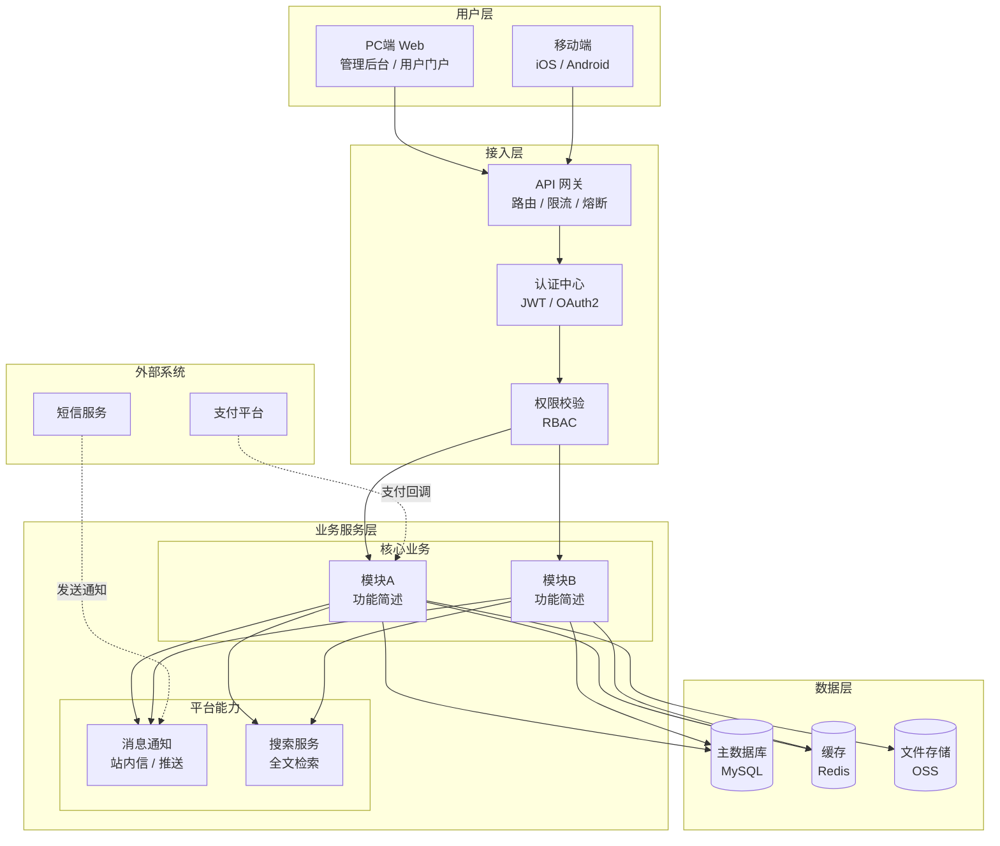

# 产品架构图生成指南

根据用户提供的产品或系统描述，生成一份结构清晰、可直接嵌入 PRD HTML 的 Mermaid `graph TB` 产品架构图。

---

## 工作流程

1. **理解产品**：从用户描述中识别：前端入口（Web/移动端等）、核心业务模块、数据存储、外部依赖。
2. **信息不足时反问**：如果无法判断业务模块划分，向用户提出具体问题，不要自行猜测核心业务。
3. **生成架构图**：严格按照下方规范输出 Mermaid 代码块。
4. **附上说明**：在图表后用简短列表说明各层的作用及关键节点。

---

## 架构分层规范

架构图必须包含以下五层（可根据产品实际情况裁剪，但顺序不变）：

| 层级       | 说明                                               | 节点示例                         |
| ---------- | -------------------------------------------------- | -------------------------------- |
| 用户层     | 产品的所有接入端                                   | PC Web、移动端、小程序、开放 API |
| 接入层     | 统一入口与安全控制                                 | API 网关、认证、权限校验、限流   |
| 业务服务层 | 核心业务逻辑，用 subgraph 分"核心业务"和"平台能力" | 订单、用户、消息、通知、搜索     |
| 数据层     | 持久化与缓存                                       | MySQL、Redis、OSS、ElasticSearch |
| 外部系统   | 第三方依赖，用虚线箭头连接                         | 支付、短信、地图、AI 服务        |

---

## 输出模板



---

## 生成规则（必须遵守）

- **五层结构**：用户层 → 接入层 → 业务服务层 → 数据层 → 外部系统，使用 `subgraph` 分组。
- **业务服务层内嵌套**：用 `subgraph 核心业务` 和 `subgraph 平台能力` 区分职责。
- **外部系统**：一律使用虚线箭头 `-.->` 并标注接口方向，如 `-.->|支付回调|`。
- **节点描述**：每个节点用 `<br/>` 换行追加功能简述，格式为 `ID[名称<br/>简述]`。
- **数据库节点**：使用圆柱语法 `[(名称)]`。
- **箭头方向**：从上游流向下游，从调用方指向被调用方。
- **节点 ID**：使用全大写英文加下划线，如 `MOD_USER`、`DB_MYSQL`，确保唯一且无特殊字符。

---

## 嵌入 PRD HTML 的写法

在 PRD 单文件 HTML 中，架构图需包裹在 `<div class="mermaid">` 中，并确保页面已引入 mermaid CDN 并调用 `mermaid.initialize()`：

```html
<div class="mermaid">graph TB ...（图表内容）...</div>

<script src="https://cdn.jsdelivr.net/npm/mermaid/dist/mermaid.min.js"></script>
<script>
	mermaid.initialize({ startOnLoad: true, theme: "default" });
</script>
```
