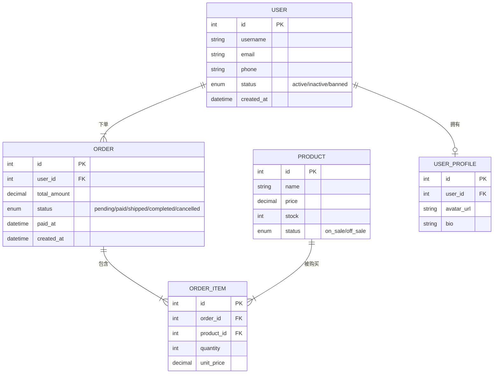

# 数据模型（ER 图）生成指南

根据用户描述的业务实体和关系，生成符合规范的 Mermaid `erDiagram` ER 图，并附带实体说明表格作为补充。

---

## 工作流程

遵循 ER 建模三步法：

1. **找实体**：从业务描述中识别核心名词（用户、订单、商品、评论等），每个名词对应一个实体。
2. **梳理关系**：明确实体之间的关系类型（一对一、一对多、多对多），多对多需要中间表。
3. **确定关键属性**：每个实体列出 PK（主键）、FK（外键）、关键业务字段、状态枚举字段。

**信息不足时反问**：如果核心实体之间的关系不明确（如"一个用户可以有多个地址吗？"），向用户确认，不要自行假设。

---

## 关系符号规范

| 符号         | 含义                 | 场景示例                        |
| ------------ | -------------------- | ------------------------------- |
| `\|\|--\|\|` | 一对一               | 用户 - 用户详情                 |
| `\|\|--\|{`  | 一对多               | 用户 - 订单                     |
| `}\|--\|{`   | 多对多（通过中间表） | 订单 - 商品（通过订单明细）     |
| `\|\|--o\|`  | 零或一对一           | 订单 - 发票（订单可以没有发票） |

---

## 输出模板



---

## 实体说明区块（紧跟 ER 图输出）

ER 图后为**每一个实体**单独输出一个区块，每个区块包含：

- 实体名作为 `h4` 标题
- 独立表格，除了可以跳过 `id PK`、`created_at`、`updated_at`这些字段，其他字段都要列出
- 每个实体必须输出区块，即使该实体只有少量需要说明的字段也不可省略

HTML 结构示例：

```html
<div class="entity-section">
	<h4 class="entity-table-title">USER</h4>
	<table class="prd-table entity-table">
		<tr>
			<th>字段</th>
			<th>类型</th>
			<th>说明</th>
		</tr>
		<tr>
			<td>status</td>
			<td>enum</td>
			<td>active=正常，inactive=未激活，banned=封禁</td>
		</tr>
	</table>
</div>

<div class="entity-section">
	<h4 class="entity-table-title">ORDER</h4>
	<table class="prd-table entity-table">
		<tr>
			<th>字段</th>
			<th>类型</th>
			<th>说明</th>
		</tr>
		<tr>
			<td>status</td>
			<td>enum</td>
			<td>
				pending=待支付，paid=已支付，shipped=已发货，completed=已完成，cancelled=已取消
			</td>
		</tr>
		<tr>
			<td>total_amount</td>
			<td>decimal</td>
			<td>下单时商品价格快照的总和，不随商品调价变化</td>
		</tr>
	</table>
</div>

<div class="entity-section">
	<h4 class="entity-table-title">ORDER_ITEM</h4>
	<table class="prd-table entity-table">
		<tr>
			<th>字段</th>
			<th>类型</th>
			<th>说明</th>
		</tr>
		<tr>
			<td>unit_price</td>
			<td>decimal</td>
			<td>下单时商品快照价格，防止商品改价影响历史订单</td>
		</tr>
	</table>
</div>

<div class="entity-section">
	<h4 class="entity-table-title">PRODUCT</h4>
	<table class="prd-table entity-table">
		<tr>
			<th>字段</th>
			<th>类型</th>
			<th>说明</th>
		</tr>
		<tr>
			<td>stock</td>
			<td>int</td>
			<td>库存数量，下单时需原子性扣减，防止超卖</td>
		</tr>
		<tr>
			<td>status</td>
			<td>enum</td>
			<td>on_sale=上架销售，off_sale=已下架</td>
		</tr>
	</table>
</div>
```

---

## 生成规则（必须遵守）

- **实体名大写**：所有实体名使用全大写英文，如 `USER`、`ORDER_ITEM`。
- **必须标 PK/FK**：每个实体必须标注主键字段（`PK`），外键字段标注（`FK`）。
- **状态字段枚举**：包含状态的字段必须在字段行内注释枚举值，如 `enum status "active/banned"`。
- **多对多必须拆中间表**：如 `ORDER` 和 `PRODUCT` 不能直接多对多，必须通过 `ORDER_ITEM` 中间实体。
- **关系标注业务含义**：关系连线上必须标注中文动词，如 `"下单"`、`"包含"`、`"被购买"`。
- **实体说明区块**：所有实体必须各自输出一个区块，不可省略；表格只列有业务规则或枚举值的字段，不重复显而易见的字段（`id`、`created_at` 等可省略）。
- **业务型产品**：涉及交易、内容、用户等核心实体时，所有核心实体和关系必须完整画出，不能遗漏。

---

## 嵌入 PRD HTML 的写法

Mermaid ER 图直接写在 `.mermaid` div 中，由页面已加载的 mermaid.js 渲染，**不要在输出中添加 CDN script 标签**：

```html
<div class="mermaid">erDiagram ...（图表内容）...</div>

<div class="entity-section">
	<h4 class="entity-table-title">ENTITY_NAME</h4>
	<table class="prd-table entity-table">
		<tr>
			<th>字段</th>
			<th>类型</th>
			<th>说明</th>
		</tr>
		...
	</table>
</div>
```
