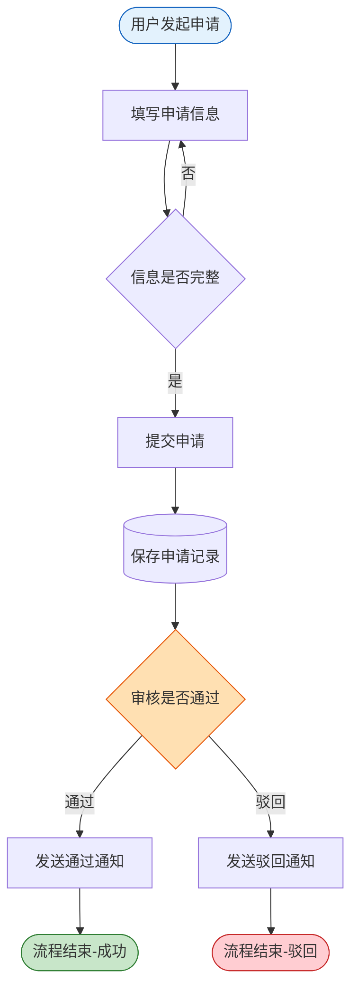
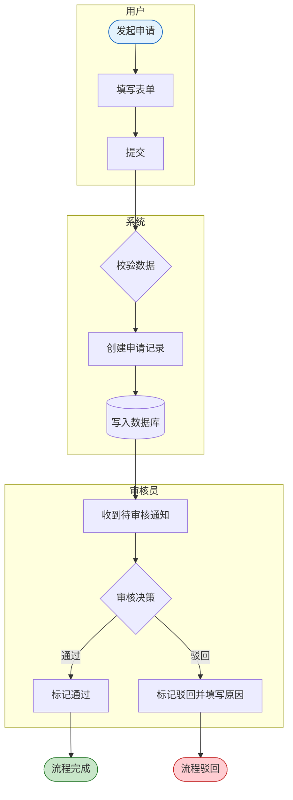

# 业务流程图生成指南

根据用户描述的业务场景，生成一份节点清晰、颜色语义明确、可直接嵌入 PRD HTML 的 Mermaid `flowchart TD` 业务流程图。

---

## 工作流程

1. **梳理关键路径**：识别流程的开始触发点、核心步骤、判断分支、成功/失败结束态。
2. **识别参与角色**：如果流程涉及多个角色（用户、系统、管理员等），需用泳道区分。
3. **信息不足时反问**：分支条件不明确、角色边界模糊时，向用户确认，不要自行假设。
4. **生成流程图**：严格按照下方节点类型和颜色规范输出。
5. **附流程说明**：在图表后用简短文字描述主流程和关键分支逻辑。

---

## 节点类型规范

| 语法      | 形状     | 用途                |
| --------- | -------- | ------------------- |
| `([...])` | 圆角矩形 | 流程开始 / 结束节点 |
| `[...]`   | 矩形     | 普通操作步骤        |
| `{...}`   | 菱形     | 判断 / 分支条件     |
| `[(..)]`  | 圆柱形   | 数据存储 / 读写操作 |

---

## 颜色语义规范（`style` 着色）

| 颜色 | 含义                 | CSS 参考值                    |
| ---- | -------------------- | ----------------------------- |
| 蓝色 | 入口 / 触发点        | `fill:#E3F2FD,stroke:#1565C0` |
| 绿色 | 成功 / 完成态        | `fill:#C8E6C9,stroke:#2E7D32` |
| 红色 | 失败 / 阻断 / 异常   | `fill:#FFCDD2,stroke:#C62828` |
| 橙色 | 等待 / 审批中 / 挂起 | `fill:#FFE0B2,stroke:#E65100` |

---

## 输出模板（单角色）



---

## 输出模板（多角色泳道）



---

## 生成规则（必须遵守）

- **节点 ID**：使用全大写英文加下划线，如 `STEP_LOGIN`、`CHECK_PERM`，每个 ID 在图中唯一。
- **节点标签**：使用中文简洁描述动作，如 `[用户填写登录表单]`。
- **开始/结束节点**：必须用 `([...])` 语法，且标注明确的开始/结束状态。
- **循环路径**：校验失败回到上一步时，箭头必须标注条件文字，如 `-->|信息不完整|`。
- **颜色**：开始节点 = 蓝色，成功结束 = 绿色，失败/异常结束 = 红色，等待/审批节点 = 橙色；普通步骤不加 style。
- **多角色**：一旦涉及 2 个以上角色，必须用 `subgraph` 划分泳道，不要混在一起。
- **subgraph 标签**：泳道名称**必须用双引号包裹**，如 `subgraph "用户"`，禁止写成 `subgraph 用户`（Mermaid 10 对非 ASCII 的 subgraph 标签强制要求引号）。

---

## 嵌入 PRD HTML 的写法

```html
<div class="mermaid">flowchart TD ...（图表内容）...</div>

<script src="https://cdn.jsdelivr.net/npm/mermaid/dist/mermaid.min.js"></script>
<script>
	mermaid.initialize({ startOnLoad: true, theme: "default" });
</script>
```
