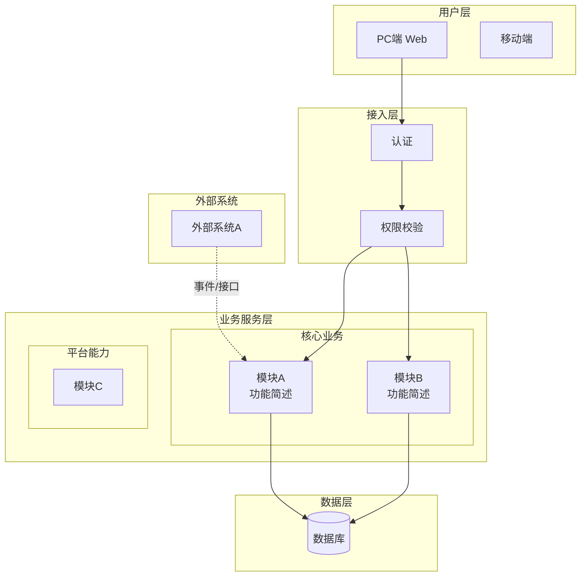
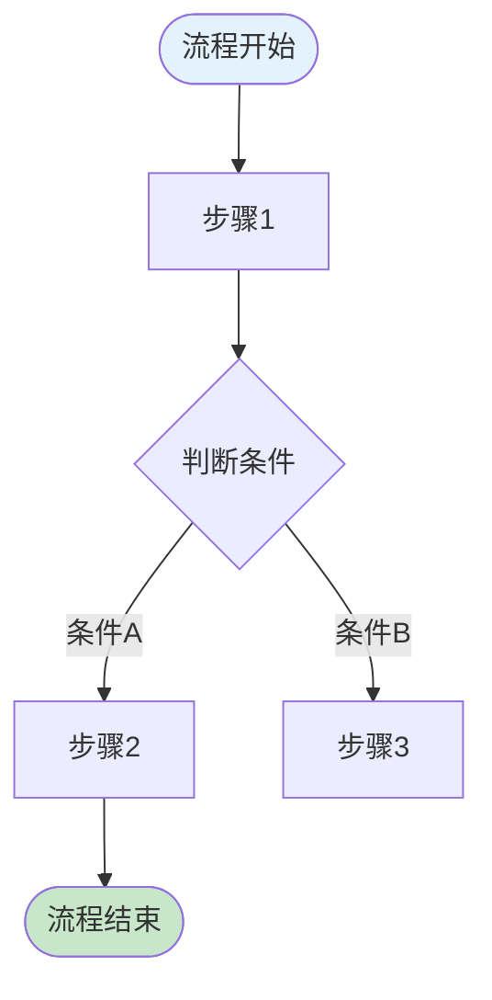
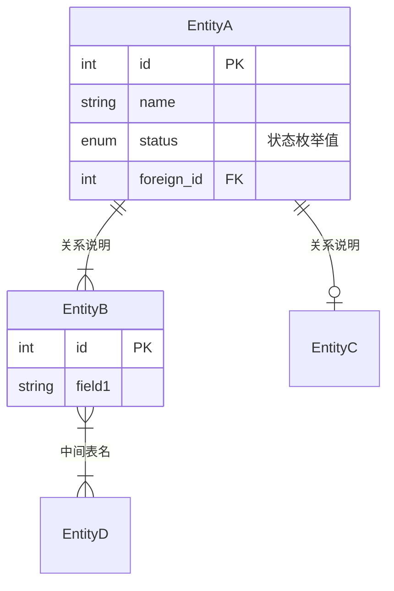

## 项目定位

- 本项目旨在开发一个基于 LLM 的智能 Agent。该 Agent 能够通过多轮对话深度分析用户的零散需求，引导用户补充关键信息，并最终一键生成结构化、包含多种专业图表且带有交互界面的产品需求文档（PRD）。

---

## Agent 核心工作流与交互原则

Agent 在与用户交互时，必须严格遵循以下工作机制：

- 信息诊断与反问机制

  > 前置评估：接收到用户需求后，Agent 首先需评估信息是否足以支撑生成一份完整的 PRD。
  > 表单式提问：当信息不足或存在歧义时，禁止自行主观臆断。Agent 需向用户输出结构化的“提问表单”。
  > 确认机制：在关键业务逻辑、核心数据流向等环节，需与用户明确确认后再进入 PRD 生成阶段。

- 工作流程
  > 理解需求 -> 信息查漏补缺（反问） -> 构建结构大纲 -> 生成图表与细节 -> 输出单文件 HTML

## 技术栈

- 前端 vue3.5 + ts + langchainjs前端 + vite8
- 后端 daemon + nodejs + express+langchainjs后端
- agent 方面是使用langchainjs驱动，但也支持切换成本地的claude code或codex (这两个都暂无需开发，先预留好口子)
- 支持引用skill,加载skill
- 所有第三方包的安装只允许使用pnpm 安装不允许使用npm 安装

---

## 前端

### 前端样式规范

**色彩系统**：

- 主色：#4F46E5（靛蓝）
- 成功：#10B981
- 警告：#F59E0B
- 错误：#EF4444
- 背景：#FFFFFF（主）、#F8FAFC（次）、#F1F5F9（第三层）

**字体**：

- 中文：Inter / PingFang SC / Noto Sans SC
- 英文：Inter / SF Pro Display
- 字号：标题 18-24px，正文 14px，辅助 12px

**圆角**：

- 卡片：8px
- 按钮：6px（小）/ 8px（大）
- 气泡：12px
- 头像：50%

**阴影**：

- 卡片：0 1px 3px rgba(0,0,0,0.1), 0 1px 2px rgba(0,0,0,0.06)
- 悬浮按钮：0 4px 6px -1px rgba(0,0,0,0.1)

---

### 具体设计稿见 `docs\assets\images`

## prd结构

### 产品背景与目标

- **背景（Context）**：为什么要做这个项目？解决什么业务痛点？
- **目标（Goals）**：期望达成的业务/用户/技术目标（建议用 SMART 原则）

### 目标用户与使用场景

- **目标用户画像**：谁会用这个产品？（角色、痛点、诉求）
- **使用场景（Scenarios）**：用户在什么情境下使用？包含前置条件、操作流程、预期结果

### 功能清单

**一个功能模块可以对应多个功能点**
| 功能模块 | 功能点 | 需求描述 | 优先级 |
| --------- | ------- | -------- | ------ |
| 功能模块1 | 功能点1 | xxxx | p1 |
| 功能模块1 | 功能点1 | xxxx | p2 |

### 产品架构

使用 `graph TD`（自上而下）或 `graph LR`（自左向右），用 `subgraph` 分层。

模板：

````md

````

**生成规则：**

- 分为用户层、接入层、业务服务层、数据层、外部系统 五层
- 业务服务层内部用 `subgraph` 区分核心业务和平台能力
- 外部系统用虚线箭头 `-.->` 表示
- 每个模块节点用 `<br/>` 换行标注功能简述

### 业务流程

使用 Mermaid `flowchart` 语法，用不同颜色的节点区分不同角色和关键状态。

模板：

````md

````

**生成规则：**

- 用 `([...])` 表示开始/结束节点（圆角）
- 用 `{...}` 表示判断/分支节点（菱形）
- 用 `[...]` 表示普通步骤
- 用 `[(..)]` 表示数据存储
- 关键状态用 `style` 着色（蓝色=入口、绿色=成功、红色=失败/阻断、橙色=等待）
- 涉及多角色时用 `subgraph` 划分泳道

### 信息架构

使用 markmap.js 绘制信息架构思维导图

### 数据模型

使用 Mermaid `erDiagram` 语法，同时保留实体说明表格作为补充。

> 💡 ER建模三步法：找到实体 → 梳理关系 → 确定关键属性

模板：

````md

````

**关系符号说明：**

- `||--||` 一对一
- `||--|{` 一对多
- `}|--|{` 多对多（通过中间表）
- `||--o|` 零或一对一

**生成规则：**

- 业务型/交易型产品：ER图必须完整，所有核心实体和关系都要画出
- 每个实体列出关键属性（PK/FK/状态/核心业务字段）
- 关系标注业务含义
- ER图后面附实体说明表格（补充属性细节和业务规则）

## prd 输出形式

- prd 最终输出成一份纯静态、可交互的 HTML 文件（包含内嵌的 CSS 和 JS）
- 有 **背景与目标**，**用户与场景**，**功能清单**，**产品架构**，**业务流程**，**信息架构**，**数据模型**，这7个 tab 标签，点击标签可以切换到对应的模块
- 上述prd结构只作为默认输出结构，也支持用户自定义prd输出结构
- 免构建渲染：所有样式和逻辑必须写在单一文件中（禁止外部依赖文件，除了 CDN）。
- 图表渲染支持：为了让生成的图表能够直接在浏览器中显示，必须在 HTML 的 <head> 或底部的 <script> 中引入必要的 CDN：
  > 引入 mermaid.js 并在脚本中执行 mermaid.initialize() 以渲染产品架构、业务流程和数据模型。
  > 引入 markmap-lib 和 markmap-view 以渲染信息架构图。
